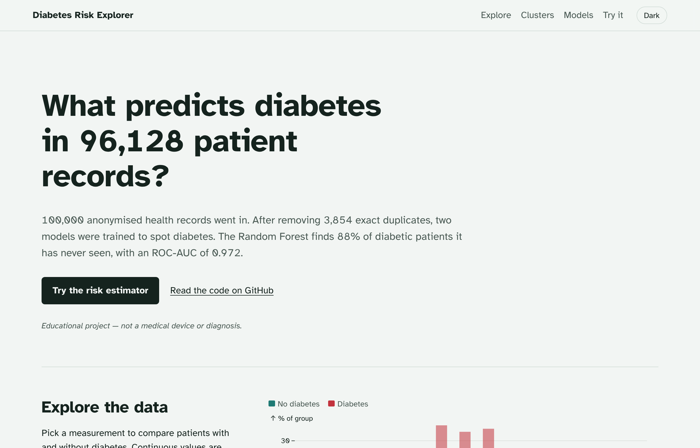
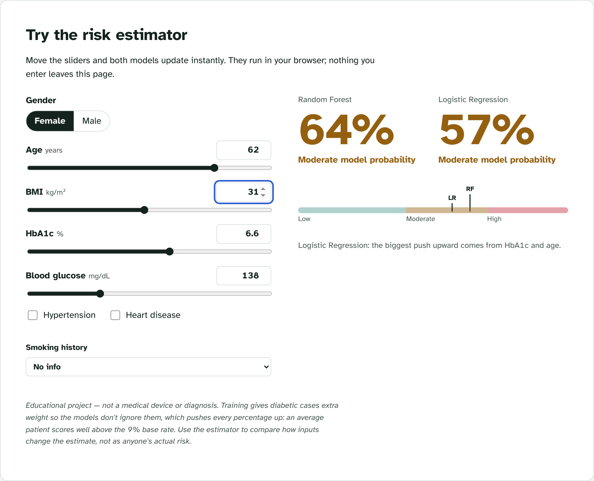
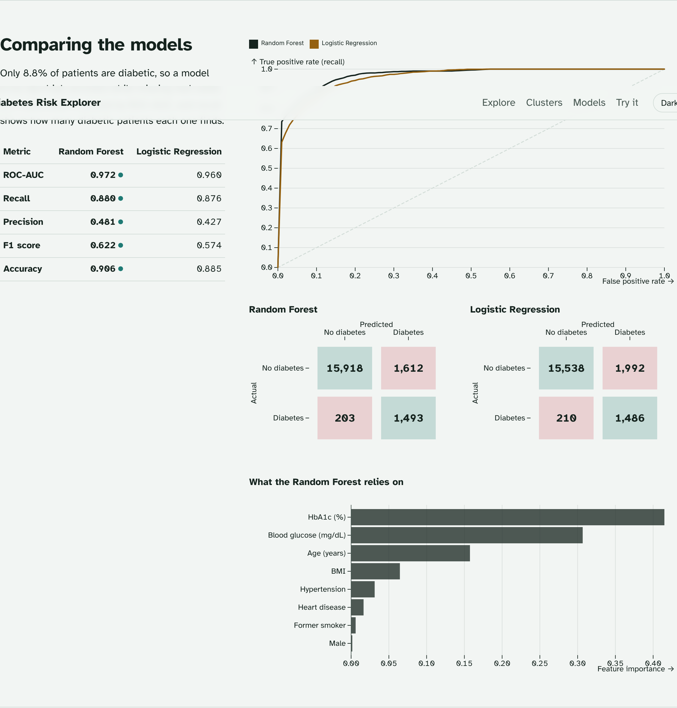
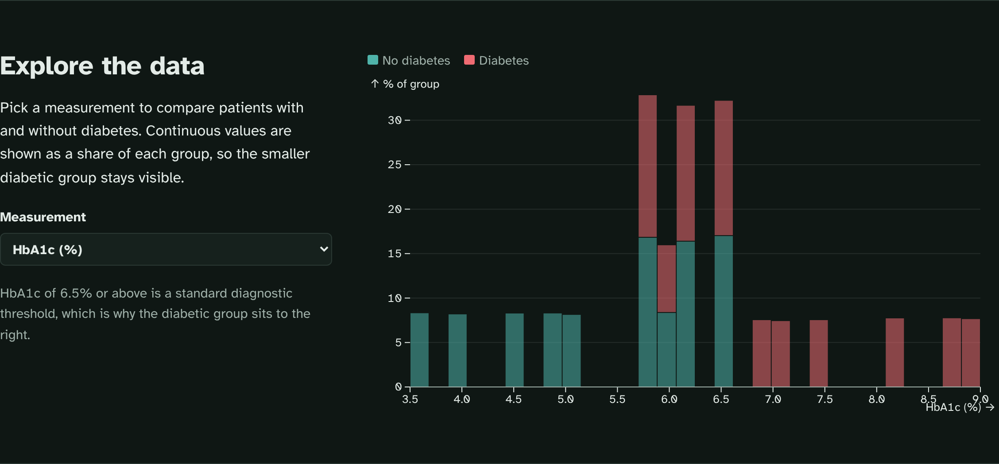
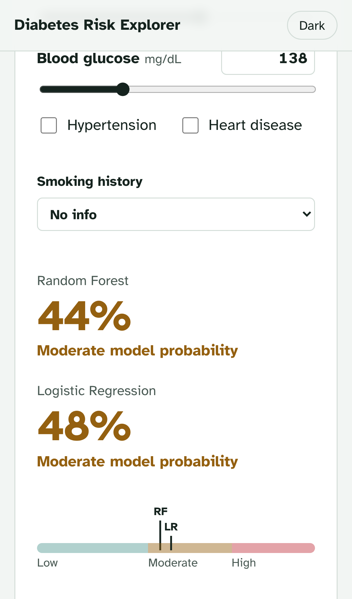

# Diabetes Risk Explorer

Explore 100,000 patient health records, compare two machine-learning models, and try a live diabetes-risk estimate in your browser.

**Live demo:** [tsakioan.com/projects/diabetes](https://tsakioan.com/projects/diabetes/)



> **Educational project — not a medical device or diagnosis.** The results describe this dataset only and are not clinically validated.

The project started as a CustomTkinter desktop app for a Gatehouse Awards qualification. It has since been rebuilt with a shared, tested Python pipeline and an interactive web version that runs entirely in the browser.

## What it does

- **Explore the data.** Compare the distributions of HbA1c, blood glucose, BMI and age for patients with and without diabetes, plus diabetes rates by gender, smoking history, hypertension and heart disease. A correlation heatmap and four research hypotheses with sources sit alongside.
- **Find patient groups.** K-means clustering on age, BMI and HbA1c finds three groups. Each group's description is generated from its actual centre and diabetes rate.
- **Compare models.** A Random Forest and a Logistic Regression are compared on ROC-AUC, recall, precision, F1 and accuracy, with ROC curves, confusion matrices and feature importance.
- **Try it live.** Move sliders for gender, age, BMI, HbA1c, glucose, hypertension, heart disease and smoking history. Both models update instantly, client-side; nothing is sent anywhere.

| Predictor | Model comparison |
|---|---|
|  |  |

| Dark mode | Phone |
|---|---|
|  |  |

## Results

On a held-out test set of 19,226 patients (stratified 80/20 split):

| Metric | Random Forest | Logistic Regression |
|---|---|---|
| ROC-AUC | **0.972** | 0.960 |
| Recall | **0.880** | 0.876 |
| Precision | **0.481** | 0.427 |
| F1 | **0.622** | 0.574 |
| Accuracy | **0.906** | 0.885 |

Only 8.8% of patients are diabetic, so the best model is chosen by ROC-AUC rather than accuracy. Both models use balanced class weights. They catch most diabetic patients, but more than half of the patients they flag are false alarms (precision below 50%). That trade-off suits screening, where a follow-up test settles it. Because of the class weighting, the predicted percentages run high (an average patient scores well above the 8.8% base rate), so the live estimator is for comparing how inputs move the estimate, not for reading off anyone's actual risk. HbA1c and blood glucose carry most of the predictive signal.

## Data preparation

The dataset (`data/sample.csv`) has 100,000 records with gender, age, hypertension, heart disease, smoking history, BMI, HbA1c, blood glucose and the diabetes outcome. Preparation steps:

- **3,854 exact duplicate rows are removed** before splitting, so identical records can't appear in both the training and test sets and inflate scores.
- **18 records with gender "Other" are excluded.** That's too few to learn anything reliable from.
- **Smoking history is one-hot encoded**, with "No info" as the baseline. Earlier versions used an arbitrary 0–5 number, which implied a false ordering.
- In a replacement dataset, rows with no diabetes outcome are dropped, missing yes/no values (hypertension, heart disease) take the most common value, missing continuous values take the column mean, and unknown smoking values count as "No info".

## Project structure

```
analysis/            Shared Python pipeline (used by both versions)
  data.py            load, dedupe, encode
  models.py          train + evaluate Random Forest and Logistic Regression
  clustering.py      K-means with stable, data-driven group labels
scripts/
  export_web.py      run the pipeline, write web/data/*.json
web/                 Static site: copy this folder to deploy
  index.html, styles.css
  js/                app.js, charts.js, predictor.js, models.js (model runtime)
  data/              generated results and exported models
  vendor/            d3, Observable Plot, Atkinson Hyperlegible font (with licences)
main.py              Desktop app (original Gatehouse version, fixed)
tests/               pytest, Node and browser tests
```

## Running it

Python 3.10 or newer is needed.

```bash
git clone https://github.com/MrTsak/AI-Data-Analytics.git
cd AI-Data-Analytics
pip install -r requirements-dev.txt
```

**Web version locally:**

```bash
python -m http.server -d web 8000
# open http://localhost:8000
```

**Desktop version** (needs Tk; on Linux install `python3-tk`):

```bash
python main.py
```

**Regenerate the web data** after changing the pipeline or dataset:

```bash
python scripts/export_web.py
```

## Deploying to a website

`web/` is a self-contained static site. It makes no external requests, uses only relative paths, and needs no build step. Copy the whole folder to your host under any path, for example:

```
your-site/
  projects/
    diabetes/   ← contents of web/
```

It then works at `https://your-site/projects/diabetes/`. Link to it with the trailing slash, since some hosts don't add it automatically and the page's relative paths need it. Any static host works (plain HTML hosting, GitHub Pages, Netlify and so on).

## How the browser predictions work

Training happens in Python. `export_web.py` writes:

- the Logistic Regression's scaler means and scales, coefficients and intercept (`model_lr.json`)
- every Random Forest tree as compact arrays of split feature, threshold, children and leaf probability (`model_rf.json`, about 240 KB)

`web/js/models.js` reimplements prediction for both, including scikit-learn's float32 input cast. A parity test checks that the browser's probabilities match scikit-learn's to within 1e-6 on 200 cases, including extreme values and inputs that sit exactly on split thresholds.

## Tests

```bash
python -m pytest tests                 # pipeline, export, desktop (desktop tests need a display)
xvfb-run -a python -m pytest tests     # include desktop tests on a headless Linux box
node --test tests/js/*.test.mjs        # JS/Python parity + browser smoke test (Playwright)
```

The smoke test serves `web/` under `/projects/diabetes/`, checks that every chart renders, and checks that the predictor responds to input.

## Licence

MIT, see [LICENSE](LICENSE). Bundled third-party files in `web/vendor/` keep their own licences: d3 (ISC), Observable Plot (ISC), and Atkinson Hyperlegible (SIL Open Font License).
